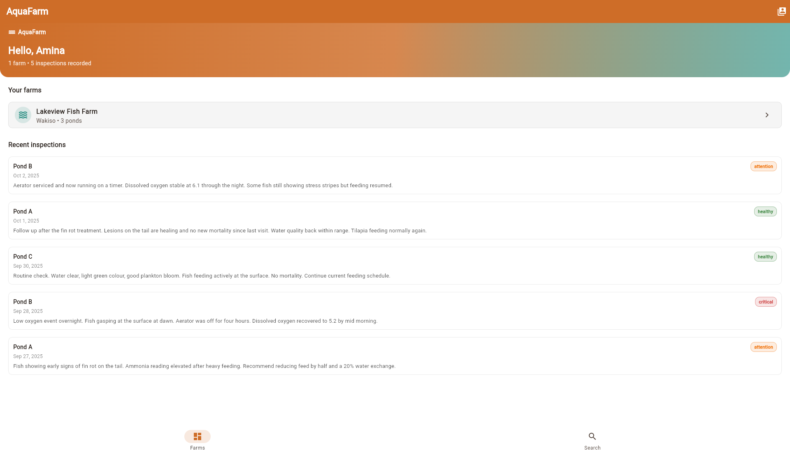
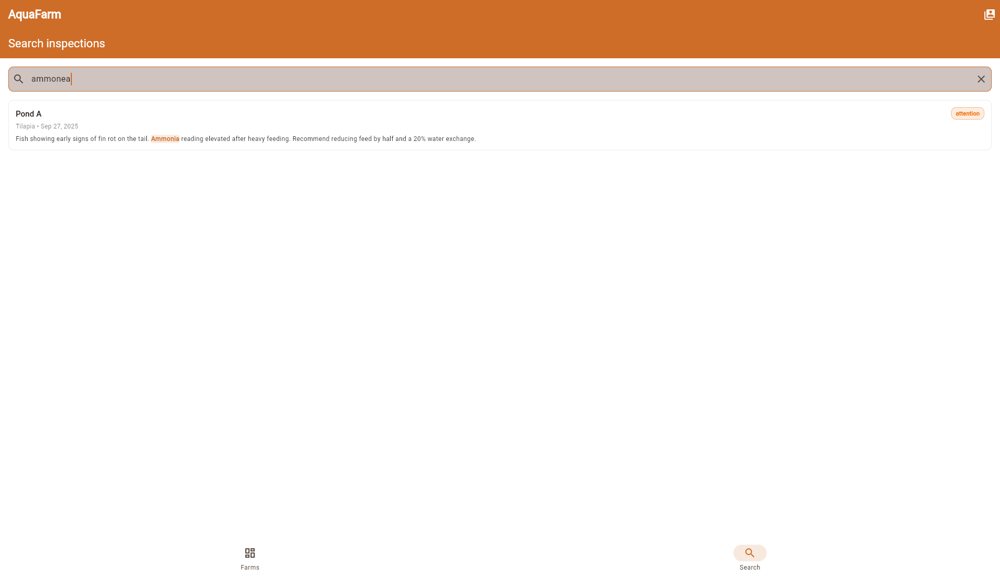
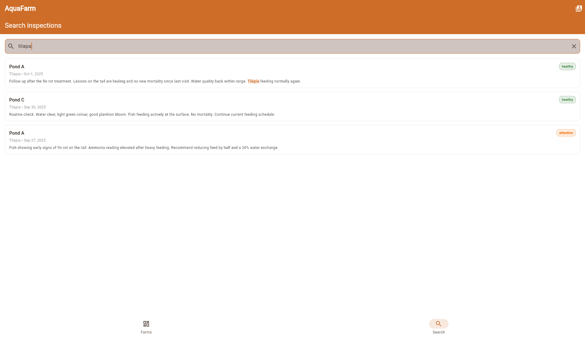

# AquaFarm — DroidCon Hackathon

A fish-farming (aquaculture) inspection app for Flutter, with **instant inspection-history search powered by Typesense**. Built for Chrome first, Android-ready.

> The beekeeping app at `ademnea/smartHiveInspector` was the reference for layout, colours and the inspection-checklist pattern. Nothing from it is copied: this is a fresh, much smaller app that keeps the same idea and drops everything that got in the way (login, bee-specific domain, sensor hardware).

---

## What it does

A farmer picks their farm, opens a pond, and records an inspection with notes plus water-quality readings (temperature, dissolved oxygen, pH, ammonia) and a mortality count.

Then the part that actually matters for this hackathon: **they can search their whole inspection history and find things even when they misspell them.**

Type `ammonea` → finds every inspection whose notes mention **ammonia**.
Type `tilapa` → finds **tilapia** stock.

Results show the pond, species, date and a snippet of the notes with the matched words highlighted. Tapping one opens the full inspection.



Searching `ammonea` still finds the notes that say **ammonia**:



The same for `tilapa` and **tilapia** stock:



There is a [59-second narrated demo](docs/aquafarm-demo.mp4) of the whole flow — picking a farmer, opening a farm and a pond, then running four searches — if you would rather watch it than run it.

---

## Why the search is built this way

**Typesense holds a search copy. It is not the database.** The API owns the data; Typesense is an index that can be deleted and rebuilt at any time.

**The Flutter app never holds an admin key.** An admin key in a shipped app can be extracted from the bundle, and whoever finds it can read and delete every farmer's data. So the app never gets one.

**The app never gets the plain search key either.** A raw search-only key can still search the entire collection — every farmer's inspections. Instead the backend mints a **scoped key** per farmer: the farmer's id is baked into the key as a `filter_by`, signed with HMAC-SHA256. Typesense itself enforces the filter, so the client cannot widen it, no matter what it sends.

```
Flutter  ──GET /api/search-key──►  API  ──generateScopedSearchKey──►  scoped key
   │                                                                        │
   └──────────────GET /collections/inspections/documents/search ◄───────────┘
                   (Typesense applies filter_by: farmer_id:=farmer_1 itself)
```

**Indexing happens on the server only**, on create and delete. A Typesense failure never fails the write — the database stays the source of truth and the index catches up.

**Offline, search still works.** If Typesense is unreachable, the app filters the inspections already in memory and shows an "Offline search" banner rather than an error.

---

## Repository layout

```
lib/
  api/
    farm_api.dart                  REST client for the mock API
    inspection_search_service.dart Typesense client: scoped key cache, search, retry
  config/
    app_config.dart                base URLs, collection name, debounce
    aqua_colors.dart               orange brand + teal accent, status colours
  models/
    farm.dart                      Farm, Pond
    inspection.dart                Inspection, InspectionSearchResult
  screens/
    farmer_picker_screen.dart      stands in for login
    root_shell.dart                tabs (Farms, Search)
    home_screen.dart               farms + recent inspections
    farm_detail_screen.dart        ponds, their inspections, search entry points
    inspection_search_screen.dart  THE FEATURE
    inspection_detail_screen.dart  one inspection in full
  widgets/
    highlighted_text.dart          renders Typesense <mark> snippets
    status_chip.dart              healthy / attention / critical
server/
  index.js                         mock API + /api/search-key
  typesense-service.js             collection schema, indexing, scoped keys
  data.js                          dummy farms, ponds, inspections
  seed.js                          create collection + bulk import
scripts/dev.sh                   one-command local setup
scripts/get-typesense.sh         fetch the Typesense binary (no Docker needed)
scripts/run-typesense.sh         start Typesense, Docker or binary
docker-compose.yml               Typesense via Compose
```

---

## Running it

You need three things: Typesense, the API, and the app.

### Fastest path

```bash
./scripts/dev.sh
```

That starts Typesense, creates the search-only key, writes `server/.env`, installs the API dependencies, seeds the collection, and runs the API. Then in a second terminal:

```bash
flutter pub get
flutter run -d chrome --dart-define=API_BASE_URL=http://localhost:8080
```

It is safe to re-run: an existing `.env` and search key are reused rather than replaced.

### 1. Typesense

**With Docker** (preferred):

```bash
docker compose up -d
```

or without Compose:

```bash
# Pick your own admin key here; put the same value in server/.env
docker run -d --name typesense \
  -p 8108:8108 \
  -v /tmp/typesense-data:/data \
  typesense/typesense:27.1 \
  --data-dir /data \
  --api-key=local-dev-key-change-me \
  --enable-cors
```

**Without Docker**: the server binary is about 325 MB and is not committed here, because GitHub rejects any file over 100 MB. Fetch the exact tested version instead:

```bash
./scripts/get-typesense.sh      # downloads v27.1 for your OS/CPU into .typesense/
./scripts/run-typesense.sh      # starts it on port 8108 with CORS on
```

The download is checked against a pinned SHA-256 (the Linux/amd64 build) and the script aborts if it does not match, so a corrupted or swapped archive never becomes your search server.

`--enable-cors` is not optional: the Flutter **web** app calls Typesense from the browser, and without it every request is blocked by CORS. Both the compose file and both run paths turn it on.

### 2. The API

```bash
cd server
cp .env.example .env      # then fill in the keys
npm install
node seed.js              # creates the collection and imports the dummy data
node index.js             # http://localhost:8080
```

### 3. The app

```bash
flutter pub get
flutter run -d chrome --dart-define=API_BASE_URL=http://localhost:8080
```

On an Android emulator, `localhost` is the device itself, so point it at your machine instead:

```bash
flutter run --dart-define=API_BASE_URL=http://10.0.2.2:8080
```

---

## The keys, and where each one lives

| Key | What it can do | Where it goes |
|---|---|---|
| Admin key | everything: create collections, read and delete every document | `server/.env` only — **never** in Flutter |
| Search-only parent key | `documents:search` on `inspections` only | `server/.env` only |
| Scoped search key | search, filtered to one farmer, expires in 24h | generated per request, held in app memory |

Create the search-only parent key once, against a running server:

```bash
curl -X POST http://localhost:8108/keys \
  -H "X-TYPESENSE-API-KEY: local-dev-key-change-me" \
  -H "Content-Type: application/json" \
  -d '{
    "description": "Flutter search-only key",
    "actions": ["documents:search"],
    "collections": ["inspections"]
  }'
```

Put the returned `value` into `TYPESENSE_SEARCH_KEY` in `server/.env`.

A scoped key is useless if it is derived from an admin key, so the parent key **must** be search-only. That is the whole point.

### If you're using Typesense Cloud

Set `TYPESENSE_HOST`, `TYPESENSE_PORT=443` and `TYPESENSE_PROTOCOL=https` in `server/.env`. Typesense Cloud has CORS on by default, so nothing else changes.

---

## The collection schema

`server/typesense-service.js` defines it, and it matches the real model field for field:

```json
{
  "name": "inspections",
  "fields": [
    { "name": "id", "type": "string" },
    { "name": "farmer_id", "type": "string", "facet": true },
    { "name": "pond_id", "type": "string", "facet": true },
    { "name": "pond_name", "type": "string" },
    { "name": "farm_name", "type": "string", "optional": true },
    { "name": "species", "type": "string", "facet": true, "optional": true },
    { "name": "inspection_date", "type": "int64" },
    { "name": "notes", "type": "string" },
    { "name": "status", "type": "string", "facet": true, "optional": true },
    { "name": "mortality_count", "type": "int32", "optional": true },
    { "name": "dissolved_oxygen", "type": "float", "optional": true },
    { "name": "water_temperature", "type": "float", "optional": true },
    { "name": "ph", "type": "float", "optional": true },
    { "name": "ammonia", "type": "float", "optional": true }
  ],
  "default_sorting_field": "inspection_date"
}
```

Nothing is indexed that the app does not actually have.

---

## API endpoints

All authenticated endpoints take `X-Farmer-Id` (the demo stand-in for a bearer token).

| Method | Path | Purpose |
|---|---|---|
| GET | `/api/farmers` | the two demo farmers |
| GET | `/api/farms` | farms for the current farmer |
| GET | `/api/ponds?farm_id=` | ponds, optionally for one farm |
| GET | `/api/inspections?pond_id=` | inspections, newest first |
| POST | `/api/inspections` | create, and index into Typesense |
| DELETE | `/api/inspections/:id` | delete, and remove from the index |
| GET | `/api/search-key` | **a scoped, short-lived search key** |
| POST | `/api/admin/seed` | rebuild the index from the data |

`GET /api/search-key` returns:

```json
{
  "success": true,
  "data": {
    "key": "…scoped key…",
    "host": "localhost",
    "port": 8108,
    "protocol": "http",
    "collection": "inspections",
    "expiresAt": 1793352000
  }
}
```

---

## Test checklist

1. `node seed.js` — creates the collection and imports 8 inspections.
2. Search **`ammonea`** → matches notes containing *ammonia*. ✅ verified
3. Search **`tilapa`** → matches *tilapia*. ✅ verified
4. Search **`fin rot`** → matches the fin-rot treatment note.
5. Switch to the other farmer and search `ammonia` → only their own ponds come back, never the other farmer's. ✅ verified
6. Stop Typesense, search again → results still appear, with the "Offline search" banner. No crash.
7. Create a new inspection, wait a moment, search for a word from its notes → it is found.

---

## Porting to the real backend

The mock API is shaped so a real Laravel backend can replace it without the app changing:

- **Identity.** Replace `currentFarmer()` in `server/index.js` with the authenticated user. Nothing else in the API depends on how identity is decided.
- **Database.** `data.js` becomes Eloquent models. `farm_name` and `species` are denormalised onto each inspection in Typesense so a search never needs a join.
- **Indexing.** Move `indexInspection` / `deleteInspection` into an Eloquent model observer, so every create, update and delete stays in sync even when written from somewhere other than the API.
- **Scoped keys.** `generateScopedSearchKey` exists in the official PHP client (`typesense/typesense-php`) as `Keys::generateScopedSearchKey()`. Same call, same result.
- **The key endpoint.** `GET /api/search-key` behind the normal auth middleware, returning the same four fields. The Flutter client needs no change at all.

The one thing that must not change: the scoped key is still derived from a **search-only** parent key, never the admin key.

---

## Deliberately out of scope

Login and registration, offline write queue and conflict resolution, real sensor ingest, photo capture, and app-store signing. Those live in the reference app and are not needed to demonstrate the search architecture.
